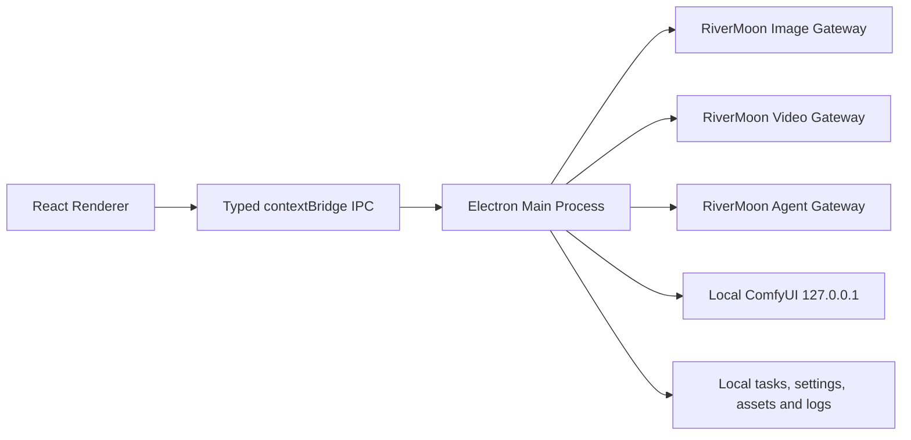

# RiverMoon AI 创作台架构

## 产品边界

桌面客户端同时提供 RiverMoon 云端 AI 创作能力与本地图片超分：

- AI 生图、AI 视频、GPT 对话通过 RiverMoon 网关执行，需要用户 API Key。
- 图片超分通过用户本机 ComfyUI/PyTorch/CUDA 执行，不上传图片。
- `rivermoon7.com` 服务端不在本仓库中。

## 进程与信任边界



Renderer 不直接访问网络或 Node.js。明文 API Key 只存在于主进程，并使用 Electron `safeStorage` 加密保存。

## 本地超分链路

```text
Renderer
-> jobs:start IPC
-> JobQueue
-> managed local ComfyUI
-> LoadImage
-> UpscaleModelLoader(4x-UltraSharp.pth)
-> ImageUpscaleWithModel
-> ImageScale(lanczos, target width/height)
-> SaveImage
-> copy output to user directory
```

- 默认最大长边 4096；`0` 表示真实 4x。
- 进度来自 ComfyUI websocket 和 history 状态，不按时间估算。
- 取消任务会调用 `/interrupt` 并删除排队 prompt。
- 输入、输出和临时文件由主进程清理。
- 模型权重不进入 Git，也不随安装包分发；用户主动下载后执行 SHA256 校验。

## AI 生图链路

```text
Renderer ImageGenModule
-> preload IPC
-> image-protocol validation
-> image-gen gateway adapter
-> RiverMoon image contract / generation / edit endpoints
-> local assets/images/YYYY-MM
-> ImageTaskQueue persistence and renderer events
```

图片模型、尺寸、质量、格式、参考图上限和自定义尺寸必须来自实时图片合同。Renderer 只展示合同允许的组合，主进程提交前再次校验。

## AI 视频链路

```text
Renderer VideoGenModule
-> preload IPC
-> HTTPS video contract validation
-> optional reference source-cache upload
-> remote job submit and polling
-> authenticated gateway or approved external CDN download
-> local assets/videos/YYYY-MM
-> VideoTaskQueue persistence and renderer events
```

- 认证请求只访问允许的 HTTPS RiverMoon 网关。
- 外部 CDN 下载不附带 API Key。
- 签名 URL 只在内存中短暂使用，不写入任务持久化和诊断。
- 任务保存远端 `job_id`，应用重启后可以恢复同步。

## GPT 对话链路

```text
Renderer AgentChatModule
-> preload IPC
-> agent-protocol request normalization
-> /v1/responses streaming adapter
-> renderer delta events
-> local conversation metadata
```

对话历史保存在本机。发送请求时，用户文本和主动添加的图片附件会上传到 RiverMoon Agent 网关。

## 持久化

开发环境默认使用项目根目录 `.local-user-data/`。正式免安装包使用 exe 同级 `user-data/`，也可通过 `RIVERMOON_USER_DATA_DIR` 覆盖。

主要文件：

```text
settings.json
jobs.json
image-tasks.json
video-tasks.json
account-key.enc
assets/
logs/
```

这些内容可能包含本机路径、提示词摘要和任务信息，全部被 `.gitignore` 排除。

## 生图无限画布边界

当前生图 UI 把参数/参考素材放在 `image-settings-rail`，把主要创作区域放在 `image-creation-stage`。未来无限画布应替换创作舞台，而不把合同、参考图校验和任务提交逻辑复制进画布组件。

## 构建与发布

- `npm run build` 只构建源码，不需要 ComfyUI runtime。
- `npm run dist:dir` 需要本机已准备 `resources/comfyui-runtime/`。
- `package.json` 会过滤所有 `.pth` 模型和旧 DiffBIR/SUPIR 资源。
- 完整免安装目录约数 GB，GitHub Release 使用分卷 7-Zip 资产。

## 质量门禁

```bash
npm run check
npm run dist:dir
npm run release:smoke
npm run release:launch-smoke
```

付费生图、视频和 GPT E2E 需要有效 Key，只能由维护者在受控环境中手动运行。
