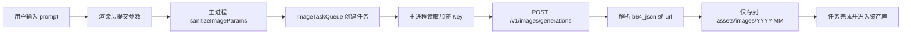
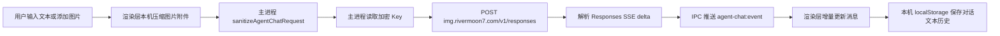
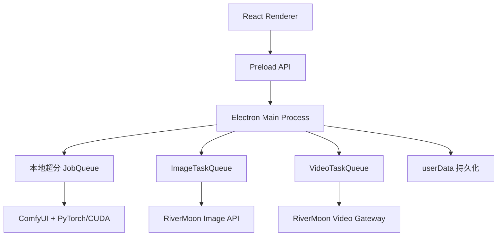

# RiverMoon 桌面创作工具产品文档

版本：v0.1.0  
文档日期：2026-07-08  
适用产品：Windows 桌面版 `RiverMoon AI 创作台`  
工作目录：`D:\rivermoon-local-upscaler`  
交付目录：`D:\rivermoon-local-upscaler\release\win-unpacked\`

---

## 0. 文档控制

| 项目 | 内容 |
| --- | --- |
| 文档类型 | 商业级产品规格、研发对齐文档、测试验收基线、发布风险清单 |
| 当前状态 | 可作为内部灰度和验收依据；不能替代真实付费 E2E、模型授权审查和法务发布审查 |
| 适用范围 | RiverMoon Windows 桌面应用：图片超分、AI 生图、AI 视频、GPT 对话、资产库、设置和诊断 |
| 不适用范围 | RiverMoon 网站前端、网站后台管理台、云端 worker 运维、生产服务器密钥管理 |
| 维护原则 | 只写代码、配置、接口或明确产品决策能证明的事实；不能把推测写成承诺 |

状态词定义：

| 状态 | 定义 |
| --- | --- |
| 已实现 | 代码链路已经存在，并至少有本地自动化或人工验证入口 |
| 首版接入 | 代码链路已经接入，但真实生产环境 E2E 或边界验证不足 |
| 待验收 | 规格明确，但必须通过真实用户环境或真实付费链路后才能对外承诺 |
| 未完成 | 尚未实现，或实现质量不足以作为发布承诺 |
| 发布阻断 | 不解决就不能定义为正式商业消费级发布 |

本文档的核心原则：

```text
本地超分可以承诺本机执行、不上传图片。
AI 生图、AI 视频和 GPT 对话是云端能力，必须承认会连接 RiverMoon 服务并消耗账户能力。
效果一致性必须靠同图、同模型、同尺寸策略、同输出链路验证，不能靠感觉判断。
```

---

## 1. 执行摘要

RiverMoon 桌面创作工具是一款面向 Windows 用户的图片、视频与对话创作应用。它的基础价值是把 RiverMoon 网站 AI 图片增强中的高频 GPU 推理转移到用户自己的 NVIDIA 显卡上运行，从而降低生产服务器远程显卡消耗；同时，它在桌面端接入 RiverMoon 账户 Key，用于云端 AI 生图、AI 视频和 GPT 对话，并把生成类结果统一保存到本机资产库。

当前产品不是通用 ComfyUI 工作台，也不是单纯的网页壳。它将三类能力放在同一个桌面体验中：

| 能力 | 执行位置 | 是否需要 Key | 是否上传用户输入 | 当前定位 |
| --- | --- | --- | --- | --- |
| 图片超分 | 用户本机 NVIDIA/CUDA | 否 | 否 | 核心基础能力 |
| AI 生图 | RiverMoon 图片网关 | 是 | prompt 与参考图会发送云端 | 已按图片工作台合同首版对齐，需真实 Key GUI 验收 |
| AI 视频 | RiverMoon 视频网关 | 是 | prompt 与参考图会发送云端 | 首版接入，真实付费 E2E 仍是阻断项 |
| GPT 对话 | RiverMoon Agent/Responses 网关 | 是 | 对话文本与图片附件会发送云端 | 首版接入，需真实 Key GUI 验收 |

当前可以对内定义为：

```text
具备商业发布雏形的灰度候选版。
```

当前不应对外定义为：

```text
已经商业消费级完成。
已经证明和网站 AI 输出 100% 一样。
所有电脑都可用。
所有视频模式都已真实付费验收。
```

原因很明确：真实视频付费 E2E、网站 AI 与桌面超分同图差分、模型商业授权、Windows 代码签名、目标用户环境回归仍没有全部闭环。

---

## 2. 当前验证快照

根据当前交接记录，最近一次完整验证结果如下：

| 验证项 | 结果 | 说明 |
| --- | --- | --- |
| `npm run lint` | 通过 | 代码规范检查通过 |
| `npm test` | 通过 | 21 个测试文件，206 个测试通过 |
| `npm run build` | 通过 | TypeScript 与 Vite 构建通过 |
| 非付费视频网关模拟 E2E | 通过 | mock HTTPS 合同、参考图上传、参考图上传瞬时错误重试、无效参考图缓存响应不重试不提交、图生视频单参考图提交、多参考图顺序与类型映射、任务提交、提交瞬时错误重试、提交参数拒绝不重试不轮询下载、queued/running/succeeded 轮询、轮询瞬时错误继续等待、轮询不可重试错误不下载、远端 failed 不下载不落盘、伪装二进制下载错误体不落盘并清理临时文件、外部签名下载失败后的网关 fallback、已有远端任务恢复同步、recent 恢复清理旧失败状态、recent 远端取消/过期清理旧错误状态、旧任务加载清理历史签名 URL、网关 302 到外部 CDN 时丢弃 Key、不安全重定向后继续 content fallback、认证 JSON 接口拒绝外部重定向、source-cache/jobs 认证 POST 拒绝外部重定向、视频下载和本地落盘；不触发真实计费 |
| `npm run release:online-smoke` | 通过，带警告 | Agent endpoint 4 pass；图片合同 16 pass；视频合同 17 pass / 1 warning；当前视频合同未暴露 `first_last_frame` |
| `npm run release:verify` | 通过，带警告 | 本轮分项验证通过：release smoke 149 pass / 3 warning；打包、结构 smoke、Agent/图片/视频/版本更新模块代码 smoke、启动 smoke 通过 |
| 打包版启动 smoke | 通过 | 打包应用可启动、渲染层加载、视频导航存在 |
| 真实视频付费 E2E | 工具已提供，真实执行仍待验收 | `npm run video:paid-e2e:dry-run` 可非计费校验生产合同和本地参数；`npm run video:paid-e2e` 只有在设置真实 Key 和精确确认短语后才会提交付费任务 |
| 真实图生视频/多参考图 E2E | 未完成 | 代码链路存在，仍需真实 Key 和真实参考图验收 |
| 网站 AI 与桌面超分同图差分 | 未完成 | 不能据此承诺 100% 一样 |
| 模型商业授权 | 未完成 | `4x-UltraSharp.pth` 有非商业授权风险 |
| Windows 代码签名 | 未完成 | 正式发布前需解决未知发布者提示 |

生产视频合同快照：

| 项目 | 当前值 |
| --- | --- |
| 合同地址 | `https://video.rivermoon7.com/v1/video/contract` |
| 合同版本 | `2026-07-06.pro666-video-models-v1` |
| 返回模型数 | 12 |
| 启用模型数 | 10 |
| 文生视频 endpoint | 6 |
| 图生视频 endpoint | 10 |
| 多参考图 endpoint | 4 |
| 首尾帧 endpoint | 0 |

结论：首尾帧视频必须保持合同门控，不能宣传为生产已开放能力。

---

## 3. 产品定位

### 3.1 一句话定位

RiverMoon 桌面创作工具是一款 Windows 本地 AI 图片超分与云端 AI 创作应用：图片超分在用户自己的 NVIDIA 显卡上运行，不上传原图；连接 RiverMoon 账户后，可生成图片和视频，并把产物保存到本机资产库。

### 3.2 商业定位

本产品解决两个业务问题：

1. 降低 RiverMoon 网站 AI 图片增强对生产服务器 GPU 的持续消耗。
2. 把 RiverMoon 云端生图、视频能力延伸到桌面端，形成“生成、超分、管理资产”的闭环。

### 3.3 产品边界

本地超分模块：

```text
本机执行
不需要 Key
不上传图片
依赖 NVIDIA/CUDA
```

AI 生图模块：

```text
云端执行
需要 RiverMoon Key
prompt 会发送云端
生成结果保存到本机
```

AI 视频模块：

```text
云端执行
需要 RiverMoon Key
prompt 会发送云端
参考图会上传到视频网关 source-cache
视频结果下载并保存到本机
```

---

## 4. 产品背景

RiverMoon 网站已经存在 AI 图片增强能力。历史网站链路中，用户点击 AI 按钮后，网站后端创建 AI enhance job，生产 worker 在指定 Windows 机器上调用本机 ComfyUI 处理图片，再把结果回传给网站。

桌面版的最初目标是把这条远程 GPU 图片处理链路迁移到用户自己的电脑上。用户拖入图片后，由本机 ComfyUI、PyTorch/CUDA 和 `4x-UltraSharp.pth` 执行超分，默认使用接近网页端历史输出的 4096 长边策略。

随着产品扩展，当前桌面端已经加入云端 AI 生图、云端 AI 视频、账户 Key、资产库和诊断能力。因此当前产品必须把“本地能力”和“云端能力”分清：

```text
本地图片超分：为了摆脱远程显卡消耗。
云端生图/视频：为了延伸 RiverMoon 账户创作能力。
```

这两个目标可以共存，但不能混淆宣传。

---

## 5. 产品目标

### 5.1 商业目标

1. 将高频图片超分推理从生产服务器 GPU 迁移到用户本机。
2. 降低 RiverMoon 网站图片增强 worker 的远程显卡负载。
3. 给存量网站用户提供桌面端处理入口。
4. 用资产库串联本地超分、云端生图和云端视频。
5. 为云端模型调用、账户余额、充值入口建立桌面端入口。
6. 建立可交付、可诊断、可版本化的 Windows 桌面产品。

### 5.2 用户目标

1. 打开软件直接进入工作区，而不是营销页。
2. 拖入图片即可处理，不需要理解 ComfyUI 或 CUDA 细节。
3. 清楚知道本地超分图片不会上传云端。
4. 连接账户后可以生成图片和视频。
5. 每个任务都有状态、进度、耗时、输出位置和失败原因。
6. 关闭重开后任务记录仍然存在。
7. 成功超分后可以用对比弹窗检查细节。
8. 出错时能导出诊断信息给支持人员。

### 5.3 研发目标

1. 固化网站同款 AI 超分链路，减少用户误选旧链路导致的效果差异。
2. 主进程统一管理 Key、文件、网络、任务队列和本地资源。
3. 渲染层不接触明文 Key，不直接读取任意本地文件。
4. 本地任务和云端任务都要持久化。
5. 云端任务要能处理停止同步、恢复同步和下载失败恢复。
6. 发布前验证必须可重复、可脚本化、可审计。

### 5.4 需求优先级矩阵

| ID | 优先级 | 需求 | 验收口径 | 当前状态 |
| --- | --- | --- | --- | --- |
| RM-P0-001 | P0 | 本地图片超分固定使用网站同款 ComfyUI 链路 | 同一版本中不能重新暴露 SUPIR、DiffBIR、NCNN/Vulkan 入口；设置规整后仍为 `4x-UltraSharp.pth` | 已实现 |
| RM-P0-002 | P0 | 本地超分不上传用户图片 | 无 RiverMoon Key 时仍可运行；抓包和日志不出现原图上传到 RiverMoon 服务 | 待验收 |
| RM-P0-003 | P0 | 本地超分进度真实可信 | 进度来自 ComfyUI websocket/history，不能按时间伪造 | 已实现 |
| RM-P0-004 | P0 | 任务记录关闭重开仍保留 | 本地超分、生图、视频任务均有持久化；异常退出后的 running/queued 状态有明确处理 | 已实现 |
| RM-P0-005 | P0 | Key 只在主进程使用并脱敏 | 渲染层只能看到掩码 Key；诊断、日志、复制文本不泄露明文 Key | 已实现，需安全复核 |
| RM-P0-006 | P0 | AI 生图走 RiverMoon 云端账户能力 | 真实 Key 至少完成一次生图并保存到资产库 | 待真实 Key 验收 |
| RM-P0-007 | P0 | AI 视频提交必须使用 HTTPS 实时合同 | 缓存合同和 HTTP 合同不能用于付费提交 | 已实现 |
| RM-P0-008 | P0 | AI 视频支持文生、图生、多参考图合同门控 | 合同支持才允许提交；合同不支持时按钮禁用并给出原因 | 已实现，需真实 E2E |
| RM-P0-009 | P0 | 视频下载不能泄露 RiverMoon Key | 外部 CDN 下载不带认证头；签名 URL 不进入诊断 | 已实现，需安全复核 |
| RM-P0-010 | P0 | 商业发布前解决模型授权 | `4x-UltraSharp.pth` 非商业风险必须有替代方案或授权文件 | 未完成 |
| RM-P0-011 | P0 | 打包版 GUI 可人工回归 | 从 `win-unpacked` 启动，完成超分、生图、视频、资产、设置核心流程 | 待人工验收 |
| RM-P0-012 | P0 | 网站 AI 与桌面超分同图差分 | 保存输入、网站输出、桌面输出、模型 hash、尺寸策略和差分结果 | 未完成 |
| RM-P1-001 | P1 | 资产库形成统一创作结果入口 | 图片和视频产物可预览、打开位置、继续处理 | 首版实现 |
| RM-P1-002 | P1 | 视频任务支持停止同步、恢复和重试 | 已提交远端任务不能因本地关闭丢失；恢复不重复扣费提交 | 已实现，需真实任务回归 |
| RM-P1-003 | P1 | 诊断能定位环境、合同、网络和任务问题 | 导出内容有足够上下文，同时脱敏 Key、路径和签名 URL | 已实现，需支持侧复核 |
| RM-P1-004 | P1 | 设置页手动检查版本更新 | 读取当前版本，检查 GitHub Release；无 Release 时回退 tag；新版本打开 GitHub 下载页 | 已实现 |
| RM-P2-001 | P2 | 静默自动更新、崩溃上报、安装包签名 | 正式商用渠道需要完整发布运营能力 | 未完成 |

---

## 6. 非目标

当前版本明确不做：

1. 不做通用 ComfyUI 工作台。
2. 不暴露任意节点编辑、采样器调参、工作流导入。
3. 不支持 AMD、Intel、CPU、DirectML 的本地超分 fallback。
4. 不把本地超分失败自动降级到云端处理。
5. 不把生产 worker token、SSH Key、服务器密钥打进 App。
6. 不在未验证前承诺桌面输出与网站 AI “100% 一样”。
7. 不在生产合同未开放时宣传首尾帧视频。
8. 不在未解决模型授权前宣传内置模型可商用。
9. 不承诺云端生图和云端视频“不上传任何数据”。

---

## 7. 用户画像

### 7.1 RiverMoon 网站存量用户

这类用户已经熟悉网站 AI 增强、生图或视频能力。他们最关注效果是否接近网站、是否少排队、是否节省云端额度。

核心诉求：

1. 本地超分效果接近网站 AI 按钮。
2. 操作比网页简单。
3. 能明确知道图片是否上传。
4. 输出文件容易找到。

### 7.2 本地 NVIDIA 显卡用户

这类用户拥有 Windows + NVIDIA 显卡，希望使用自己的设备处理图片。

核心诉求：

1. 用自己的显卡，不消耗服务器显卡。
2. 支持批量图片处理。
3. 进度和耗时真实可信。
4. CUDA 或模型缺失时有明确提示。

### 7.3 内容创作者

这类用户同时需要生成图片、生成视频和高清放大。

核心诉求：

1. 一站式生成图片、生成视频、保存资产。
2. 生图产物可继续本地超分。
3. 视频任务有清楚的排队、生成、下载和失败状态。
4. 资产库可以统一管理结果。

### 7.4 支持与运营人员

这类用户不一定直接创作，但需要定位用户问题。

核心诉求：

1. 用户能导出诊断日志。
2. 诊断中不泄露 Key、完整路径、签名 URL。
3. 能判断是环境问题、网络问题、模型问题还是云端服务问题。

---

## 8. 信息架构

当前主导航：

```text
RiverMoon
├─ 图片超分
├─ AI 生图
├─ AI 视频
├─ GPT 对话
├─ 资产库
└─ 设置
```

模块职责：

| 模块 | 职责 | 执行位置 | 是否需要 Key |
| --- | --- | --- | --- |
| 图片超分 | 图片高清放大、任务记录、前后对比 | 本机 | 否 |
| AI 生图 | 文本生成图片，保存到资产库 | 云端 | 是 |
| AI 视频 | 文本/参考图生成视频，保存到资产库 | 云端 | 是 |
| GPT 对话 | 文本对话、图片分析、本机历史 | 云端推理 + 本机历史 | 是 |
| 资产库 | 汇总图片和视频产物 | 本机展示 | 取决于产物来源 |
| 设置 | 账户 Key、诊断、关于、模型状态 | 本机管理 | 配置云端能力时需要 |

---

## 9. 核心链路

### 9.1 本地图片超分链路

```mermaid
flowchart LR
  A["用户拖入或选择图片"] --> B["主进程校验路径白名单"]
  B --> C["JobQueue 创建本地任务"]
  C --> D["读取图片尺寸与 alpha"]
  D --> E["计算目标尺寸"]
  E --> F["复制图片到 ComfyUI input"]
  F --> G["提交 ComfyUI prompt"]
  G --> H["4x-UltraSharp.pth 超分"]
  H --> I["Lanczos 缩放到目标尺寸"]
  I --> J["SaveImage 输出 PNG"]
  J --> K["复制到输出目录"]
  K --> L["更新任务记录与对比预览"]
```



固定工作流：

```text
LoadImage
-> UpscaleModelLoader(4x-UltraSharp.pth)
-> ImageUpscaleWithModel
-> ImageScale(Lanczos, target width/height)
-> SaveImage
```

默认策略：

```text
最大长边 4096
用户填 0 时按真实 4x 输出
```

### 9.2 云端 AI 生图链路



### 9.3 云端 AI 视频链路

```mermaid
flowchart LR
  A["启动或提交前同步视频合同"] --> B["UI 展示合同允许的模型与模式"]
  B --> C["用户输入 prompt 和参数"]
  C --> D["主进程 sanitizeVideoParams"]
  D --> E["HTTPS 实时合同校验"]
  E --> F["需要参考图时上传 source-cache"]
  F --> G["POST /v1/video/jobs"]
  G --> H["轮询 /v1/video/jobs/{job_id}"]
  H --> I["成功后下载视频"]
  I --> J["保存到 assets/videos/YYYY-MM"]
  J --> K["任务完成并进入资产库"]
```



### 9.4 云端 GPT 对话链路



要点：

- 默认模型 `gpt-5.5`，默认推理强度 `medium`。
- 请求使用 Responses API 风格：`model`、`stream=true`、`input[]`、`reasoning_effort`。
- 图片附件在渲染层压缩为最长边 1600 的 JPEG data URL 后作为 `input_image` 发送。
- Key 只在主进程读取；渲染层只接收流式文本事件。

视频提交必须使用 HTTPS 实时合同。HTTP 或缓存合同只允许用于展示或降级读取，不能用于付费任务提交。

---

## 10. 功能规格：图片超分

### 10.1 产品定位

图片超分是当前桌面应用的基础能力。它用于替代网站 AI 图片增强中的远程 GPU worker，让用户使用自己的本机 NVIDIA 显卡处理图片。

核心承诺：

```text
本地执行
不上传图片
不需要 RiverMoon Key
固定网站同款 AI 链路
```

### 10.2 输入方式

支持：

1. 拖拽图片。
2. 选择单张或多张图片。
3. 选择文件夹并递归发现图片。
4. 从 AI 生图资产一键发起本地超分。

图片选择器支持：

```text
PNG
JPG/JPEG
WebP
```

### 10.3 输出规则

默认输出到输入图片同目录下：

```text
upscaled/
```

如果用户选择输出目录，则输出到指定目录。

网站同款 AI 模式输出固定为：

```text
PNG
```

输出文件名必须避免覆盖已有文件。

### 10.4 尺寸策略

默认最大长边：

```text
4096 px
```

真实 4x：

```text
maxSide = 0
output = input * 4
```

限制：

```text
maxSide <= 0 视为不限制
maxSide 正数时规整到 256 到 16384
```

### 10.5 任务状态

本地超分任务状态：

```text
queued
running
succeeded
failed
cancelled
```

每条任务记录至少包含：

| 字段 | 说明 |
| --- | --- |
| `id` | 本地任务 ID |
| `inputPath` | 输入图片路径 |
| `outputPath` | 输出图片路径 |
| `fileName` | 文件名 |
| `status` | 任务状态 |
| `settings` | 生效设置 |
| `createdAt` | 创建时间 |
| `startedAt` | 开始时间 |
| `finishedAt` | 结束时间 |
| `durationMs` | 总耗时 |
| `progress` | 进度 |
| `message` | 当前消息 |
| `error` | 失败原因 |
| `dimensions` | 原图尺寸 |
| `targetDimensions` | 目标尺寸 |
| `outputBytes` | 输出文件大小 |

### 10.6 进度要求

进度必须来自真实 ComfyUI 事件或状态：

1. 优先监听 websocket `progress_state`。
2. 兼容旧 `progress` 事件。
3. 通过 `/history/{prompt_id}` 判断完成。
4. websocket 不可用时回退轮询 history。

禁止：

1. 按时间伪造进度。
2. 无事件时线性推进百分比。
3. ComfyUI 执行失败后仍显示成功。

### 10.7 取消行为

取消 queued 任务：

```text
直接标记 cancelled，耗时为 0。
```

取消 running 任务：

```text
AbortController 打断本地任务。
调用 ComfyUI /interrupt。
尝试从 ComfyUI queue 删除 prompt。
释放 GPU 资源。
```

### 10.8 对比弹窗

成功任务支持：

1. 原图/结果滑块对比。
2. 缩放。
3. 放大后拖动画面。
4. 重置视图。
5. 展示尺寸变化。

### 10.9 资源检测

检测内容：

1. ComfyUI Runtime。
2. Python 路径。
3. `4x-UltraSharp.pth` 模型。
4. CUDA 可用性。
5. NVIDIA 设备列表。
6. 缺失项和修复建议。

检测卡只作为侧边状态，不应阻断首屏主流程。

### 10.10 模型下载

当前应用包含模型状态和按需下载入口：

| 能力 | IPC/API |
| --- | --- |
| 查询模型状态 | `getModelStatus()` |
| 开始下载 | `downloadModel()` |
| 取消下载 | `cancelModelDownload()` |
| 监听下载进度 | `onModelDownload()` |

模型授权必须明确提示：

```text
4x-UltraSharp.pth
CC-BY-NC-SA 4.0
仅限非商业
```

正式商业发布前必须替换为可商用模型，或取得授权，或把模型交由用户自行下载并承担授权责任。

---

## 11. 功能规格：AI 生图

### 11.1 产品定位

AI 生图是云端能力。用户连接 RiverMoon 账户 Key 后，可以调用该 Key 可用的图片模型生成图片。生成结果保存到本机资产库，并可继续送入本地超分。

核心边界：

```text
需要 Key
走 RiverMoon 云端
prompt 会发送云端
可能消耗账户额度或计费资源
产物保存到本机
```

### 11.2 模型来源

桌面端通过账户状态获取当前 Key 可用模型：

```text
GET https://rivermoon7.com/v1/models
```

UI 会从账户模型列表中筛选可能的图片模型。筛选关键字包括：

```text
image
dall
flux
seedream
stable
sd3
cogview
wanx
```

如果没有匹配模型，UI 应展示账户返回的全部模型，避免模型命名差异导致不可用。

### 11.3 参数规格

| 字段 | 规则 |
| --- | --- |
| `model` | 必填，优先来自 `https://img.rivermoon7.com/v1/image/contract` 的可见模型，并与账户模型取交集 |
| `prompt` | 必填，trim 后最多 4000 字符 |
| `size` | 来自图片合同；当前 `gpt-image-2` 支持 `1024x1024`、`1536x1024`、`1024x1536`、`2048x2048`、`2048x1152`、`3840x2160`、`2160x3840`、`auto` 和合同允许的自定义尺寸 |
| `count` | 1 到 4 |
| `quality` | 来自合同；当前 `gpt-image-2` 支持 `low`、`medium`、`high`、`auto` |
| `outputFormat` | 来自合同；当前支持 `png`、`jpeg`、`webp` |
| `fitMode` | `contain` 完整留白或 `cover` 居中裁切，默认 `contain` |
| `sizeMode` | `postprocess` 默认安全后处理或 `native` 原生直出 |
| `referencePaths` | 参考图路径；非空时走 `/v1/images/edits`，主进程校验白名单、格式和大小 |

### 11.4 请求规格

图片能力合同：

```text
GET https://img.rivermoon7.com/v1/image/contract
```

无参考图时：

```text
POST https://img.rivermoon7.com/v1/images/generations
Authorization: Bearer <key>
Content-Type: application/json
```

请求体示例：

```json
{
  "model": "gpt-image-2",
  "prompt": "用户提示词",
  "n": 1,
  "size": "3840x2160",
  "quality": "high",
  "output_format": "png",
  "fit_mode": "contain"
}
```

有参考图时：

```text
POST https://img.rivermoon7.com/v1/images/edits
Authorization: Bearer <key>
Content-Type: multipart/form-data
```

FormData 字段：

| 字段 | 说明 |
| --- | --- |
| `model` | 图片模型 |
| `prompt` | 用户提示词；多参考图时会加入顺序绑定提示，支持 `@图1`、`@图2` |
| `n` | 张数 |
| `size` | 目标尺寸 |
| `quality` | 质量 |
| `output_format` | 输出格式 |
| `fit_mode` | `contain` 或 `cover` |
| `size_mode` | 原生直出时传 `native` |
| `image` | 可重复字段，按用户选择顺序上传参考图 |

参考图规则：

```text
JPG / PNG / WebP / GIF
单张默认不超过 20MB
当前 gpt-image-2 最多 20 张
```

### 11.5 响应兼容

支持：

1. `b64_json`
2. `url`

输出目录：

```text
userData/assets/images/YYYY-MM/
```

文件名：

```text
YYYY-MM-DD-HH-mm-ss_序号.{png|jpg|webp}
```

### 11.6 任务能力

1. 生图任务并发数为 2。
2. 支持取消 queued/running。
3. 支持失败后重试。
4. 支持余额不足时显示充值入口。
5. 支持清空已结束任务。
6. 成功图片支持打开位置。
7. 成功图片支持一键本地超分到 4K。
8. 支持图片工作台同款质量、格式、4K 尺寸、原生直出、自定义尺寸。
9. 支持参考图编辑，参考图路径只在主进程使用。
10. 支持六宫格、九宫格、故事板模板快速填充提示词。

### 11.7 超时与重试

| 项目 | 当前值 |
| --- | --- |
| 单次生图请求超时 | 5 分钟 |
| 图片下载超时 | 60 秒 |
| 瞬时错误退避 | 2 秒、5 秒 |

---

## 12. 功能规格：AI 视频

### 12.1 产品定位

AI 视频是云端能力。当前桌面端已接入视频合同、模型选择、文生视频、图生视频、多参考图视频、任务提交、轮询、下载、恢复同步和诊断脱敏。

核心边界：

```text
需要 Key
走 video.rivermoon7.com
prompt 会发送云端
参考图会上传到 /v1/video/source-cache
视频结果下载到本机资产库
真实付费 E2E 仍需验收
```

### 12.2 当前生产合同

生产合同：

```text
https://video.rivermoon7.com/v1/video/contract
```

当前能力：

| 模式 | 规范 endpoint | 当前合同状态 | 产品状态 |
| --- | --- | --- | --- |
| 文生视频 | `text_to_video` | 有 endpoint | 首版接入，真实 E2E 待验收 |
| 图生视频 | `image_to_video` | 有 endpoint | 首版接入，真实 E2E 待验收 |
| 多参考图视频 | `reference_to_video` | 有 endpoint，保留原始 `multi_reference` 提交值 | 首版接入，真实 E2E 待验收 |
| 首尾帧视频 | `first_last_frame` | 0 endpoint | UI/提交必须合同门控，不可宣传 |

### 12.3 参数规格

| 字段 | 规则 |
| --- | --- |
| `model` | 必填，来自 HTTPS 实时合同 |
| `prompt` | 必填，trim 后最多 8000 字符 |
| `endpoint` | `text_to_video`、`image_to_video`、`reference_to_video`、`first_last_frame` |
| `requestEndpoint` | 主进程按合同写入，保留服务端原始 endpoint |
| `aspectRatio` | 必须在模型合同允许列表内 |
| `duration` | 必须在模型合同允许列表内，sanitize 后 1 到 60 |
| `resolution` | 必须在模型合同允许列表内 |
| `referencePaths` | text 模式必须为空；其他模式按合同限制 |
| `referenceTypes` | 必须和参考图数量一致 |

### 12.4 参考图规格

允许扩展名：

```text
jpg
jpeg
png
webp
gif
```

大小限制：

```text
单张不超过 20MB
```

内容校验：

1. JPG 校验 SOI 头。
2. PNG 校验 PNG 文件头。
3. WebP 校验 RIFF/WEBP。
4. GIF 校验 GIF87a/GIF89a。

参考图类型：

```text
ordinary
reference
first_frame
last_frame
character
style
```

首尾帧模式要求：

```text
第 1 张必须是 first_frame
第 2 张必须是 last_frame
```

但由于当前生产合同没有开放 `first_last_frame`，此模式不能作为已发布能力。

### 12.5 提交流程

1. 渲染层只收集参数和本地路径。
2. 主进程 `sanitizeVideoParams()` 规整参数。
3. 文生视频强制清空参考图。
4. 主进程校验参考图路径是否在白名单。
5. 提交前强制请求 HTTPS 实时视频合同。
6. `validateVideoParamsAgainstContract()` 校验模型、模式、比例、时长、清晰度、参考图数量和参考图类型。
7. 需要参考图时逐张上传到 `/v1/video/source-cache`。
8. 使用合同中的 `requestEndpoint` 提交 `/v1/video/jobs`。
9. 使用 `client_request_id` 做本地/远端幂等与诊断关联。

响应兼容要求：

1. 任务详情兼容 `data.job` 和 `raw_response_json.data.job` 包装。
2. 任务列表兼容 `data.jobs` 和 `raw_response_json.results` 包装。
3. 下载地址、费用、扣费、退款、进度字段优先从规范字段解析，同时兼容上游嵌套 `data/result/output`。

### 12.6 任务状态

视频任务状态：

```text
queued
running
succeeded
failed
cancelled
expired
```

任务字段：

| 字段 | 说明 |
| --- | --- |
| `remoteJobId` | 远端视频任务 ID |
| `requestId` | 远端 request ID |
| `clientRequestId` | 本地提交关联 ID |
| `progress` | 远端返回的真实进度，允许 null |
| `dryRun` | 远端 dry-run 标记 |
| `contentUrl` | 内容 URL，持久化时需安全化 |
| `downloadUrl` | 下载 URL，持久化时需安全化 |
| `estimatedCostUsd` | 合同预估费用 |
| `costUsd` | 远端实际费用 |
| `charged` | 是否扣费 |
| `refunded` | 是否退款 |

### 12.7 轮询与下载

| 项目 | 当前值 |
| --- | --- |
| 提交超时 | 120 秒 |
| 参考图上传超时 | 120 秒 |
| 单次轮询超时 | 30 秒 |
| 轮询间隔 | 3.5 秒 |
| 执行总等待 | 45 分钟 |
| 下载超时 | 5 分钟 |
| 下载最大文件 | 2GB |
| 瞬时轮询错误上限 | 5 次 |

下载安全要求：

1. RiverMoon 视频网关认证请求必须 HTTPS。
2. 第三方下载 URL 不附带 RiverMoon Key。
3. 下载 URL 片段和敏感 query 不持久化。
4. 拒绝 JSON、HTML、XML 错误体伪装成视频。
5. 校验视频文件头。
6. 下载使用 `.download` 临时文件，成功后 rename。
7. 启动时清理残留 `.download` 文件。

### 12.8 停止与恢复

视频任务“取消”分两类：

| 场景 | 行为 |
| --- | --- |
| 远端尚未提交 | 本地取消，不产生远端任务 |
| 已有 `remoteJobId` | 停止本地同步；远端可能仍在处理或计费 |

可恢复任务：

1. 有 `remoteJobId`。
2. 没有本地 `outputPath`。
3. 状态为 stopped sync、failed 且有下载/内容 URL，或重启后标为 queued。

恢复行为：

1. 用现有 `remoteJobId` 轮询远端。
2. 如果远端成功，继续下载视频。
3. 如果远端失败，显示远端失败原因。
4. 不应重复提交新付费任务，除非用户明确选择重试且任务没有远端 ID。

### 12.9 禁用生成按钮

生成按钮禁用时必须显示具体原因，而不是只变灰。

典型原因：

1. 未连接账户。
2. 视频合同不可用。
3. 合同来自缓存或 HTTP，不能提交付费任务。
4. 未选择模型。
5. prompt 为空。
6. 当前模式缺少参考图。
7. 参考图数量超过模型上限。
8. 当前模型不支持所选模式/比例/时长/清晰度。

---

## 13. 功能规格：资产库

### 13.1 产品定位

资产库用于汇总桌面端生成或处理出的本地文件。它不是云端网盘，不负责同步用户历史云端资产。

资产来源：

1. 本地超分输出图片。
2. AI 生图输出图片。
3. AI 视频输出视频。

### 13.2 资产目录

生图资产：

```text
userData/assets/images/YYYY-MM/
```

视频资产：

```text
userData/assets/videos/YYYY-MM/
```

本地超分默认资产：

```text
输入图片同目录/upscaled/
```

### 13.3 基础能力

1. 展示生成结果。
2. 打开文件所在位置。
3. 对图片产物发起本地超分。
4. 对视频产物使用本地媒体 URL 预览。
5. 仅允许访问主进程白名单内路径。

### 13.4 后续增强

1. 筛选图片/视频。
2. 搜索 prompt 或文件名。
3. 删除本地文件。
4. 批量导出。
5. 标记收藏。

---

## 14. 功能规格：设置、账户与诊断

### 14.1 账户 Key

Key 保存策略：

1. 主进程保存明文到内存。
2. Windows safeStorage 可用时，使用 DPAPI 加密后落盘。
3. safeStorage 不可用时，只保存在内存，重启后需重填。
4. 渲染层只能拿到掩码 Key。
5. 设置新 Key 失败时，如果旧 Key 仍有效，应保留旧连接。

禁止：

1. 日志打印明文 Key。
2. 诊断导出明文 Key。
3. 渲染层持有明文 Key。
4. 认证请求降级到 HTTP。

### 14.2 账户状态

账户状态包含：

1. 是否连接。
2. 掩码 Key。
3. 可用模型列表。
4. 总额度。
5. 已用额度。
6. 错误信息。

### 14.3 充值入口

充值入口只允许打开白名单域名：

```text
https://rivermoon7.com
```

禁止任意 URL 注入。

### 14.4 诊断导出

诊断内容应包含：

1. 应用版本。
2. Electron 和 Node 版本。
3. 平台与架构。
4. ComfyUI Runtime 状态。
5. 模型列表。
6. 本地超分工作流描述。
7. 模型大小。
8. 模型 SHA256。
9. 硬件检测结果。
10. 视频网关检测结果。
11. 最近日志。

诊断不得包含：

1. 明文 Key。
2. 完整用户路径。
3. 完整签名 URL query。
4. 完整敏感 prompt。
5. 生产服务器密钥。
6. SSH 凭据。

### 14.5 版本更新

设置页提供手动检查更新能力。

当前策略：

1. 当前版本来自 `app.getVersion()`。
2. 主进程优先请求 GitHub latest Release。
3. 如果 latest Release 返回 404，则回退读取最新 tag。
4. 有新版本时，渲染层只显示结果；打开外部页面必须走主进程 GitHub 仓库白名单。
5. 当前不做静默自动更新，不覆盖运行中的 exe 或 `win-unpacked` 目录。

更新检查地址：

```text
https://api.github.com/repos/MoonFlower-King/rivermoon-local-upscaler/releases/latest
https://api.github.com/repos/MoonFlower-King/rivermoon-local-upscaler/tags?per_page=1
```

打开页面白名单：

```text
https://github.com/MoonFlower-King/rivermoon-local-upscaler/releases
https://github.com/MoonFlower-King/rivermoon-local-upscaler/tags
```

---

## 15. 数据与持久化

### 15.1 用户数据目录

开发或本地 release 环境优先使用项目根下：

```text
.local-user-data/
```

正式打包环境使用：

```text
win-unpacked/user-data/
```

如果目录不可写，则回退 Electron 默认 `userData`。

### 15.2 持久化文件

| 文件 | 内容 |
| --- | --- |
| `jobs.json` | 本地超分任务记录 |
| `settings.json` | 超分设置 |
| `relay-key.json` | 加密后的 RiverMoon Key |
| `video-contract-cache.json` | 视频合同缓存 |
| `video-tasks.json` | 视频任务记录 |
| 图片资产目录 | 生图输出 |
| 视频资产目录 | 视频输出 |

### 15.3 任务保存策略

本地超分：

1. 最多保存 300 条。
2. 按 `createdAt` 倒序展示。
3. 高频进度节流保存。
4. 终态和退出前同步保存。
5. 上次关闭仍 running/queued 的任务标记为取消。

AI 生图：

1. 最多保存 200 条。
2. 上次关闭仍 running/queued 的任务标记为中断。
3. 输出路径和文件大小持久化。

AI 视频：

1. 最多保存 100 条。
2. 已提交远端但未下载完成的任务可恢复。
3. 参考图本地路径在远端提交后会最小化为占位，减少隐私泄露。
4. 持久化下载 URL 时必须使用安全化 URL。

---

## 16. 安全与隐私

### 16.1 Electron 安全基线

当前主窗口配置：

1. `contextIsolation: true`
2. `nodeIntegration: false`
3. `sandbox: true`
4. preload 通过 `contextBridge` 暴露受控 API。
5. 禁止新窗口。
6. 阻止非白名单导航。
7. 打包版注入 CSP。
8. 单实例锁防止多开抢任务文件和 ComfyUI 端口。

### 16.2 文件访问边界

渲染层不能任意读取本地文件。主进程维护路径白名单：

1. 用户通过文件对话框选择的路径。
2. 拖拽发现的路径。
3. 本地任务生成的输入/输出路径。
4. 生图/视频任务生成的输出路径。
5. 视频任务已选择的参考图路径。

只有白名单路径允许：

1. 预览。
2. 打开所在位置。
3. 发起本地超分。
4. 获取本地媒体 URL。

### 16.3 网络边界

本地超分：

```text
不需要连接 RiverMoon 服务器。
不上传图片。
```

AI 生图：

```text
连接 https://img.rivermoon7.com。
同步 /v1/image/contract 图片能力合同。
发送 prompt、模型、尺寸、数量、质量、输出格式、适配模式。
参考图编辑模式会上传参考图。
```

AI 视频：

```text
连接 https://video.rivermoon7.com。
发送 prompt、模型、比例、时长、清晰度。
图生/参考图模式会上传参考图。
```

### 16.4 URL 和 Key 保护

1. 认证请求只走 HTTPS。
2. 第三方下载 URL 不附带 RiverMoon Key。
3. URL query 和 fragment 不进入日志或诊断。
4. 本地任务诊断中 prompt、路径、Key、签名 URL 必须脱敏。
5. 本地 `client_request_id` 可掩码；远端 `job_id` 和 `request_id` 可保留用于支持定位。

---

## 17. 技术架构

### 17.1 运行时架构



### 17.2 关键源码

| 文件 | 职责 |
| --- | --- |
| `src/main/main.ts` | Electron 主进程、IPC、安全边界、诊断导出 |
| `src/main/job-queue.ts` | 本地超分任务队列 |
| `src/main/jobs-store.ts` | 本地超分任务持久化 |
| `src/main/comfy-engine.ts` | 内置 ComfyUI 启动、prompt 提交、进度监听、输出复制 |
| `src/main/comfy-protocol.ts` | ComfyUI workflow、history、进度解析 |
| `src/main/hardware-probe.ts` | CUDA 和本机资源检测 |
| `src/main/settings.ts` | 网站同款 AI 设置规整 |
| `src/main/cloud/key-store.ts` | Key 加密保存 |
| `src/main/cloud/account.ts` | 账户状态与模型列表 |
| `src/main/cloud/agent-protocol.ts` | GPT 对话请求体、模型过滤、Responses SSE 解析 |
| `src/main/cloud/agent-gen.ts` | GPT 对话网关请求与流式输出 |
| `src/main/cloud/image-gen.ts` | 云端生图请求与落盘 |
| `src/main/cloud/image-queue.ts` | 生图任务队列 |
| `src/main/cloud/video-gen.ts` | 视频合同、上传、提交、轮询、下载、诊断 |
| `src/main/cloud/video-protocol.ts` | 视频合同和任务协议解析 |
| `src/main/cloud/video-queue.ts` | 视频任务队列、恢复、recent 合并、持久化 |
| `src/main/cloud/video-url.ts` | 视频下载 URL 安全策略 |
| `src/main/cloud/video-cleanup.ts` | 残留 `.download` 清理 |
| `src/main/diagnostics-redaction.ts` | 诊断脱敏 |
| `src/renderer/main.tsx` | React UI |
| `src/renderer/video-submit-state.ts` | 视频生成按钮禁用原因 |
| `src/renderer/video-reference-types.ts` | 参考图类型 UI 状态 |
| `src/renderer/video-diagnostics.ts` | 复制诊断文本脱敏 |

### 17.3 打包策略

`package.json` 中打包资源包括：

1. `dist/**/*`
2. `package.json`
3. `resources/comfyui-runtime`
4. `docs`
5. `build/icon.ico`

当前打包过滤掉：

1. DiffBIR 相关 custom_nodes。
2. SUPIR 相关 custom_nodes。
3. diffbir 模型。
4. checkpoints。
5. runtime 内其他 upscale `.pth`。

注意：交付时必须复制整个 `win-unpacked` 目录，不能只复制 exe。

---

## 18. 用户体验原则

### 18.1 首屏原则

1. 打开软件直接进入工作区。
2. 不用营销 hero。
3. 图片超分是第一优先工作流。
4. 资源检测和 CUDA 检查作为侧边卡片，不压住主流程。

### 18.2 状态表达

1. 运行中显示“已用”。
2. 完成后显示“耗时”。
3. 失败必须显示可读原因。
4. 禁用按钮必须显示禁用原因。
5. 远端视频任务停止同步时必须提示“远端可能仍在处理或计费”。

### 18.3 商业可用体验标准

1. 用户不需要懂模型路径。
2. 用户不需要懂 ComfyUI。
3. 用户不需要猜任务是否还在跑。
4. 用户不需要猜图片有没有上传。
5. 用户不需要翻日志才能知道缺少什么环境。
6. 支持人员可以靠诊断定位大类问题。

---

## 19. 错误处理

### 19.1 本地超分错误

常见错误：

| 错误 | 用户提示方向 | 研发排查方向 |
| --- | --- | --- |
| 缺少 ComfyUI Runtime | 安装完整版或准备 runtime | `resources/comfyui-runtime`、`comfyMainPath()` |
| 缺少模型 | 下载 `4x-UltraSharp.pth` | `findComfyModel()`、模型 hash |
| CUDA 不可用 | 更新 NVIDIA 驱动或检查显卡 | `hardware-probe.ts`、ComfyUI 日志 |
| ComfyUI 启动超时 | 导出诊断日志 | 端口、Python、依赖损坏 |
| 输出失败 | 检查输出目录权限 | `buildOutputPath()`、写盘权限 |

### 19.2 生图错误

常见错误：

| 错误 | 处理 |
| --- | --- |
| Key 缺失 | 引导设置账户 |
| Key 无效 | 不保存新 Key，保留旧有效连接 |
| 余额不足 | 显示充值入口 |
| 上游瞬时错误 | 退避重试 |
| 返回无图片 | 标记失败并显示服务返回异常 |

### 19.3 视频错误

常见错误：

| 错误 | 处理 |
| --- | --- |
| 合同不可用 | 禁用生成，提示同步失败 |
| 合同来自缓存 | 禁止提交付费任务 |
| HTTPS 合同失败 | 禁止提交，要求检查网络 |
| 模型不支持所选模式 | 禁用生成或提交前拒绝 |
| 参考图格式错误 | 本地拦截 |
| 参考图超过 20MB | 本地拦截 |
| 瞬时轮询失败 | 最多重试 5 次 |
| 远端已提交但同步中断 | 标记可恢复 |
| 下载失败 | 保留可恢复任务，允许恢复同步 |

---

## 20. 发布与交付

### 20.1 构建命令

```bash
npm run build
npm run dist:dir
```

生成目录：

```text
D:\rivermoon-local-upscaler\release\win-unpacked\
```

可执行文件：

```text
D:\rivermoon-local-upscaler\release\win-unpacked\RiverMoon AI 创作台.exe
```

### 20.2 验证命令

每次代码改动至少执行：

```bash
npm run build
```

发版前执行：

```bash
npm run lint
npm test
npm run release:online-smoke
npm run video:paid-e2e:dry-run
npm run release:verify
npm run release:github:assets
npm run release:github:preflight
```

真实付费视频 E2E 手动门禁：

```bash
npm run video:paid-e2e
```

该命令不属于默认 `release:verify`。它会提交真实视频任务，必须同时设置 RiverMoon Key 和精确确认短语：

```text
RIVERMOON_PAID_VIDEO_E2E_CONFIRM=I_UNDERSTAND_THIS_SUBMITS_PAID_VIDEO_JOBS
```

可配置的模式：

```text
text_to_video
image_to_video
reference_to_video
first_last_frame
```

当前生产合同未开放 `first_last_frame` 时，该模式必须继续保持不可提交。

### 20.3 人工验收

打包版必须人工验证：

1. 从 `release\win-unpacked\RiverMoon AI 创作台.exe` 启动。
2. 首屏直接进入工作区。
3. 右侧资源检测卡可用。
4. 拖入 PNG/JPG/WebP 能创建任务。
5. 本地超分能成功输出。
6. 关闭重开后任务记录仍在。
7. 对比弹窗能缩放和拖动。
8. 模型缺失时提示和下载入口正常。
9. 设置 Key 后账户状态正常。
10. 生图合同同步正常，模型显示 `GPT Image 2` 等站点标签。
11. 生图尺寸包含站点合同中的 4K 尺寸，质量、格式、原生直出、自定义尺寸控件可用。
12. 生图任务在真实测试 Key 下成功。
13. 生图参考图编辑在真实测试 Key 下成功，参考图顺序和 `@图1` 等引用有效。
14. 视频合同同步正常。
15. 视频生成按钮在不可提交时显示具体原因。
16. `npm run video:paid-e2e` 在 `text_to_video` 模式下使用真实 Key 成功提交、轮询、下载、预览。
17. `npm run video:paid-e2e` 在 `image_to_video` 和 `reference_to_video` 模式下使用真实 Key 成功完成图生视频和多参考图视频 E2E。
18. 导出诊断日志不泄露 Key、完整路径、签名 URL。

### 20.4 交付规则

交付免安装版时，必须交付整个目录：

```text
win-unpacked/
```

不能只交付：

```text
RiverMoon AI 创作台.exe
```

原因：

1. Electron 需要同目录 DLL 和资源。
2. `resources/app.asar` 不在 exe 内。
3. `resources/comfyui-runtime` 是本地超分运行基础。
4. 文档和图标也在资源目录内。

### 20.5 GitHub Release 交付

当前 `win-unpacked` 包含 ComfyUI、PyTorch 和 CUDA runtime，发布目录约 6GB。GitHub Release 单个 asset 必须小于 2GiB，因此不能上传一个完整 zip。

GitHub Release 使用分卷 7-Zip：

```bash
npm run release:github:assets
npm run release:github:preflight
```

输出目录：

```text
release\github\
```

必须上传：

1. `RiverMoon-AI-Studio-vX.Y.Z-portable.7z.001`、`.002`、`.003` 等全部分卷。
2. `SHA256SUMS-vX.Y.Z.txt`。
3. `manifest-vX.Y.Z.json`。
4. `README-DOWNLOAD-vX.Y.Z.txt`。

Release 说明使用：

```text
release\github\RELEASE_NOTES-vX.Y.Z.md
```

用户下载说明必须明确：

1. 下载全部分卷。
2. 所有分卷放在同一个目录。
3. 用 7-Zip 打开 `.7z.001` 解压。
4. 解压后运行完整 `win-unpacked` 目录中的 exe。
5. 不支持只下载或复制 exe。

---

## 21. 商业发布 Definition of Done

正式定义为商业消费级发布前，必须同时满足：

1. `npm run lint` 通过。
2. `npm test` 通过。
3. `npm run build` 通过。
4. `npm run dist:dir` 通过。
5. `npm run release:online-smoke` 通过。
6. `npm run release:verify` 通过；warning 必须逐条确认是否允许发布。
7. `npm run release:github:assets` 已生成分卷、SHA256、manifest 和 Release notes。
8. `npm run release:github:preflight` 通过。
9. 打包版 GUI 人工回归通过。
10. 本地超分 PNG/JPG/WebP 至少各跑通一张。
11. 默认 4096 长边和真实 4x 两种模式均验收通过。
12. 网站 AI 与桌面超分完成同图差分，并保存可复查记录。
13. 生图使用真实 Key 至少完成一次成功任务。
14. 视频文生视频使用真实 Key + HTTPS 完成一次成功任务。
15. 视频下载结果可播放、可打开位置、可在资产库预览。
16. 图生视频真实 E2E 通过。
17. 多参考图视频真实 E2E 通过。
18. 首尾帧视频只有在生产合同开放后才能验收；否则 UI 和宣传都必须隐藏或门控。
19. 视频停止同步、恢复同步、下载失败恢复、recent 合并去重通过人工回归。
20. Key 保存、清除、脱敏、诊断导出通过安全验收。
21. 认证请求确认只走 HTTPS。
22. 第三方下载 URL 确认不附带 RiverMoon Key。
23. 至少在普通家庭网络、代理/TUN 网络、无代理网络各完成一次视频网关检测。
24. `4x-UltraSharp.pth` 商业授权问题已解决，或发布版不内置非商业模型并明确提示。
25. Windows 代码签名完成，或正式声明仍是未签名灰度版。
26. 用户协议、隐私政策、支持入口完成。
27. 对外宣传材料不出现本文档列出的禁止口径。

只要任一 P0 条件未满足，产品只能定义为内部测试版或灰度版，不能定义为正式商业消费级发布版。

### 21.1 商业验收用例矩阵

| 用例 ID | 模块 | 场景 | 输入/前置条件 | 期望结果 | 自动化状态 |
| --- | --- | --- | --- | --- | --- |
| AC-UP-001 | 图片超分 | PNG 默认 4096 长边超分 | NVIDIA/CUDA 可用，模型已安装，输入 PNG | 任务成功，输出 PNG，长边不超过 4096，记录包含耗时 | 需人工/本机验收 |
| AC-UP-002 | 图片超分 | JPG 真实 4x 超分 | `maxSide=0`，输入 JPG | 输出尺寸为原图 4 倍，输出路径不覆盖原文件 | 需人工/本机验收 |
| AC-UP-003 | 图片超分 | WebP 批量超分 | 选择多张 WebP | 多任务按队列执行，成功/失败互不阻塞 | 需人工/本机验收 |
| AC-UP-004 | 图片超分 | ComfyUI 真实进度 | 正常执行一张大图 | UI 进度随 ComfyUI 事件/history 变化，不出现假进度 | 部分自动化 |
| AC-UP-005 | 图片超分 | 缺少模型 | 删除或移动模型文件 | UI 显示模型缺失、下载入口和修复建议 | 需人工/本机验收 |
| AC-UP-006 | 图片超分 | 关闭重开任务记录 | 完成至少 2 个任务后退出重开 | 最新任务在最前，耗时和输出路径仍存在 | 自动化+人工 |
| AC-UP-007 | 图片超分 | 对比弹窗 | 打开成功任务对比 | 支持滑块、缩放、拖动、重置，文本不重叠 | 需人工验收 |
| AC-AGENT-001 | GPT 对话 | 文本对话 | 真实 Key、可用 `gpt-5.5` 或聊天模型 | 通过 `img.rivermoon7.com/v1/responses` 流式返回文本，Key 不进渲染层 | 自动化 mock，需真实 Key |
| AC-AGENT-002 | GPT 对话 | 图片分析 | 真实 Key、1 到 4 张图片 | 图片压缩为最长边 1600 JPEG，以 `input_image` 提交，模型不支持时拦截 | 需真实 Key/人工 |
| AC-AGENT-003 | GPT 对话 | 历史与取消 | 已有对话或流式输出中 | 对话文本本机保存；取消会 abort 当前请求，不影响其他模块 | 自动化+人工 |
| AC-IMG-001 | AI 生图 | Key 连接 | 输入真实 RiverMoon Key | 账户状态显示连接成功，渲染层仅显示掩码 Key | 需真实 Key |
| AC-IMG-002 | AI 生图 | 文本生成图片 | 真实 Key、可用图片模型、prompt | 云端返回图片并保存到资产库 | 需真实 Key |
| AC-IMG-003 | AI 生图 | 图片合同对齐 | 可访问 `img.rivermoon7.com` | 解析 `2026-06-07.phase1` 合同，展示站点同款模型、4K 尺寸、质量、格式、原生直出 | 自动化+人工 |
| AC-IMG-004 | AI 生图 | 参考图编辑 | 真实 Key、1 到多张参考图 | 走 `/v1/images/edits` FormData，参考图顺序保持，输出保存到资产库 | 自动化 mock，需真实 Key |
| AC-IMG-005 | AI 生图 | 自定义尺寸 | `gpt-image-2`，合同允许比例和尺寸 | 合法尺寸可提交，非法比例/超限尺寸被拦截 | 自动化+人工 |
| AC-IMG-006 | AI 生图 | 分镜模板 | 输入主题并选择六宫格/九宫格/故事板 | 提示词按模板填充，不覆盖用户内容时无误操作 | 需人工验收 |
| AC-IMG-007 | AI 生图 | 余额不足 | 使用余额不足测试 Key 或 mock | 任务失败并显示充值引导，不误报为普通网络错误 | 部分自动化 |
| AC-IMG-008 | AI 生图 | 生成图继续超分 | 生图成功产物 | 可一键发起本地超分，路径通过主进程白名单 | 需人工验收 |
| AC-VID-001 | AI 视频 | 合同同步 | 可访问 `video.rivermoon7.com` | HTTPS 合同解析成功，模型和模式按合同展示 | 自动化 smoke |
| AC-VID-002 | AI 视频 | 文生视频 | 真实 Key、合同支持模型、prompt | 任务提交、轮询成功、下载视频、资产库可预览 | 待真实付费 E2E |
| AC-VID-003 | AI 视频 | 图生视频 | 真实 Key、1 张有效参考图 | 参考图上传 source-cache，远端任务成功，视频下载落盘 | 待真实付费 E2E |
| AC-VID-004 | AI 视频 | 多参考图视频 | 真实 Key、2 到 8 张有效参考图 | 保持参考图顺序和类型，远端任务成功 | 待真实付费 E2E |
| AC-VID-005 | AI 视频 | 首尾帧合同未开放 | 当前生产合同 `first_last_frame=0` | UI 不允许宣传或提交首尾帧任务 | 自动化+人工 |
| AC-VID-006 | AI 视频 | 停止同步 | 已提交远端任务运行中，本地取消同步 | 本地提示远端可能仍在处理或计费，不伪装为远端取消 | 自动化+人工 |
| AC-VID-007 | AI 视频 | 恢复远端任务 | 已提交但未下载完成的任务 | 恢复只 poll/download，不重新 POST，不重复上传参考图 | 自动化 mock |
| AC-VID-008 | AI 视频 | 外部 CDN 下载 | 网关返回外部 HTTPS 下载地址 | 不携带 RiverMoon Key，失败后走网关 fallback | 自动化 mock |
| AC-VID-009 | AI 视频 | 不安全重定向 | JSON 认证接口被重定向到外部域名或 HTTP | 拒绝请求，不向外部地址发送认证头 | 自动化 mock |
| AC-ASSET-001 | 资产库 | 图片/视频产物展示 | 已有生图和视频结果 | 资产可预览、打开位置，路径受主进程保护 | 需人工验收 |
| AC-SET-001 | 设置/诊断 | 导出诊断 | 连接 Key、存在任务、存在失败日志 | 诊断包含定位信息，但不含明文 Key、完整路径、签名 query | 自动化+人工 |
| AC-SET-002 | 设置/版本更新 | 手动检查更新 | 可访问 GitHub；当前版本低于 Release 或 tag | 显示当前/最新版本；无 Release 时给出中文提示；下载页只打开当前仓库 releases/tags | 自动化+人工 |
| AC-REL-001 | 发布 | 免安装目录交付 | 使用 `release\win-unpacked` | 从 exe 启动成功；只复制 exe 时明确不作为支持交付 | launch smoke+人工 |

### 21.2 验收证据归档要求

每次准备对外发布，都需要在发版记录中保存以下证据：

1. `npm run lint`、`npm test`、`npm run build`、`npm run release:online-smoke`、`npm run release:verify` 的命令结果。
2. 打包目录结构截图或清单，证明交付的是完整 `win-unpacked`。
3. 本地超分三种输入格式的原图、输出图、任务记录截图、耗时、模型 hash。
4. 网站 AI 与桌面超分同图对比包：原图、网站输出、桌面输出、尺寸、模型、差分结论。
5. 真实 Key 生图成功记录：任务 ID、模型、输出文件、扣费/额度变化截图；不得保存明文 Key。
6. 真实视频文生、图生、多参考图任务记录：本地任务 ID、远端 job_id、模型、模式、输出文件、可播放证明；不得保存签名 URL query。
7. 诊断脱敏样例，证明 Key、完整路径、签名 URL 已被处理。
8. 模型授权文件或替代模型决策记录。
9. Windows 签名状态，或未签名灰度版的明确发布声明。
10. GitHub Release 页面链接和 tag 名，证明设置页检查更新可发现该版本。

---

## 22. 风险清单

### 22.1 效果一致性风险

风险：用户认为桌面超分和网站 AI 效果不同。

可能原因：

1. 使用的不是同一输入图。
2. 网站链路不是当前文档中的 ComfyUI 超分链路。
3. 模型文件 hash 不一致。
4. ComfyUI 版本或节点行为不同。
5. 尺寸策略不同。
6. 网站后处理或压缩不同。
7. 用户拿“超分”结果和“AI enhance/生图修复”结果比较。

控制措施：

1. 固化工作流和模型。
2. 诊断中记录模型 hash 和 prompt 模板。
3. 建立同图差分测试。
4. 禁止承诺“100% 一样”，直到证据闭环。

### 22.2 硬件兼容风险

风险：用户没有 NVIDIA/CUDA 或驱动不兼容。

控制措施：

1. UI 明确检测结果。
2. 提供缺失项和修复建议。
3. 文档明确无 AMD/Intel/CPU fallback。

### 22.3 模型授权风险

风险：非商业模型用于商业分发。

控制措施：

1. UI 和文档提示授权。
2. 商业版替换模型或取得授权。
3. 发布前做合规审查。

### 22.4 云端视频风险

风险：视频网关 TLS、DNS、合同、下载 URL 或付费任务失败。

控制措施：

1. 认证请求只走 HTTPS。
2. 提交前强制实时 HTTPS 合同。
3. 提供视频网关诊断。
4. 不把 HTTP/cache 合同用于付费提交。
5. 真实付费 E2E 未完成前不宣布商业级完成。

### 22.5 密钥泄露风险

风险：Key 出现在日志、诊断、渲染层或 HTTP 请求。

控制措施：

1. Key 只在主进程使用。
2. safeStorage 加密保存。
3. 渲染层只显示掩码。
4. 诊断脱敏。
5. HTTPS 强制门控。

### 22.6 打包体积风险

风险：ComfyUI、PyTorch、CUDA runtime 体积较大，分发成本高。

控制措施：

1. 打包过滤未使用模型和旧资源。
2. 模型按需下载。
3. 明确交付完整目录。
4. 后续可拆分 runtime 包。

---

## 23. 指标体系

### 23.1 产品体验指标

1. 首次打开到开始处理图片步骤数。
2. 本地超分成功率。
3. 生图成功率。
4. 视频成功率。
5. 平均任务耗时。
6. 失败任务重试成功率。
7. 任务记录保留率。
8. 资产打开次数。

### 23.2 商业指标

1. 网站图片增强远程 GPU 使用量下降。
2. 本地超分日活。
3. 账户 Key 连接率。
4. 云端生图/视频任务转化率。
5. 充值入口点击率。
6. 桌面端留存。

### 23.3 技术指标

1. 应用启动成功率。
2. 白屏率。
3. ComfyUI 启动失败率。
4. CUDA 检测失败率。
5. 模型缺失率。
6. Key 校验失败率。
7. 视频合同同步失败率。
8. 视频下载失败率。
9. 未捕获异常数量。

---

## 24. 支持与故障处理

### 24.1 支持分级

| 级别 | 场景 | 响应策略 |
| --- | --- | --- |
| P0 | 应用无法启动、Key 泄露、错误扣费、打包白屏 | 阻断发布，优先修复 |
| P1 | 本地超分无法跑通、视频无法提交或下载 | 当日定位，给出修复或绕行方案 |
| P2 | 单个模型不可用、个别文件失败、网络超时 | 收集诊断，进入迭代 |
| P3 | 文案、布局、筛选、搜索等体验优化 | 纳入路线图 |

### 24.2 报障必须收集

1. 应用版本。
2. Windows 版本。
3. 是否有 NVIDIA 显卡。
4. NVIDIA 驱动版本。
5. 错误截图或错误文案。
6. 诊断日志。
7. 本地超分任务 ID 或视频 `job_id`。
8. 输入图片格式、尺寸、大小。
9. 是否使用代理/VPN/TUN/企业网络。
10. 是否从完整 `win-unpacked` 启动。

禁止要求用户提供：

1. 明文 API Key。
2. 生产服务器 SSH Key。
3. worker token。
4. 私密原图，除非用户明确同意并走专门支持渠道。

### 24.3 常见问题判断

| 现象 | 优先判断 | 研发排查 |
| --- | --- | --- |
| 启动白屏 | 打包资源缺失或前端构建失败 | `resources/app.asar`、主窗口加载日志 |
| 提示缺少环境 | Runtime 或模型缺失 | `hardware-probe.ts`、模型状态 |
| CUDA 不可用 | 驱动或 PyTorch CUDA 不匹配 | ComfyUI 启动日志 |
| 效果不像网站 | 链路或输入不一致 | 模型 hash、尺寸策略、prompt 模板 |
| Key 校验失败 | Key 或网络问题 | `/v1/models` 响应、safeStorage |
| 视频合同失败 | 网关、DNS、TLS、代理问题 | 视频网关诊断 |
| 视频下载失败 | URL、响应类型、写盘权限 | `video-url.ts`、`.download` 临时文件 |

---

## 25. 路线图

### 25.1 P0 发布阻断

1. 真实 Key + HTTPS 文生视频 E2E。
2. 真实视频下载和打包版预览验证。
3. 真实图生视频 E2E。
4. 真实多参考图视频 E2E。
5. 网站 AI 与桌面超分同图差分。
6. 模型商业授权解决。
7. Windows 代码签名或灰度版明确声明。
8. 打包版 GUI 完整人工回归。

### 25.2 P1 重要增强

1. 视频成本明细更清楚。
2. 生图和视频失败分类更细。
3. 资产库筛选、删除、搜索。
4. 诊断包一键导出。
5. 模型下载源和校验体验增强。
6. 发布页文案、下载包命名和设置页更新提示统一。

### 25.3 P2 商业化增强

1. 静默自动更新。
2. 崩溃报告。
3. 标准安装包和免安装包双渠道。
4. 企业白标配置。
5. 可商用超分模型替换。
6. 用户协议和隐私政策内置。

### 25.4 暂不做

1. 多超分引擎自由切换。
2. SUPIR。
3. Vulkan/NCNN 轻量入口。
4. 任意 ComfyUI workflow。
5. 远程 GPU fallback 兜底本地超分。
6. 把生产 worker 凭据打进桌面端。

---

## 26. 对外宣传口径

### 26.1 推荐口径

```text
RiverMoon 桌面版支持本地 AI 图片超分和云端 AI 创作。图片超分在用户自己的 Windows 电脑上运行，使用本机 NVIDIA 显卡处理，图片不上传云端；连接 RiverMoon 账户后，还可以生成图片和短视频，并自动保存到本机资产库。
```

### 26.2 谨慎口径

```text
本地超分链路已按 RiverMoon 网站 AI 高清修复 worker 的 ComfyUI 工作流实现，默认使用 4x-UltraSharp 和 4096 长边策略。
```

### 26.3 禁止口径

发布前禁止写：

1. “100% 和网站完全一样”。
2. “所有电脑都能用”。
3. “不需要任何环境”。
4. “所有 AI 能力都本地运行”。
5. “AI 生图和 AI 视频不上传任何数据”。
6. “模型可商用无风险”。
7. “首尾帧视频已正式开放”。
8. “正式商业消费级完成”。

正确表达：

```text
本地超分不上传图片；AI 生图和 AI 视频会调用云端模型。
```

---

## 27. 当前结论

RiverMoon 桌面应用当前已经具备本地超分、云端生图、云端视频、资产库、账户和诊断的产品雏形。它的核心价值仍然是把网站 AI 图片增强中的远程 GPU 成本迁移到用户本机。

本地超分链路已经按当前确定的 ComfyUI + PyTorch/CUDA + `4x-UltraSharp.pth` 工作流实现，并通过任务持久化、真实进度、对比预览、模型状态和诊断能力形成了可交付基础。

AI 生图是云端账户能力，代码链路已实现，但仍需用真实 Key 覆盖更多模型和失败场景。

AI 视频是首版增强能力，已经实现合同解析、HTTPS 提交门控、参考图上传、任务提交、轮询、下载、恢复和诊断脱敏；但真实付费 E2E、图生视频、多参考图视频和打包版 GUI 人工验收仍未全部完成。

当前可以对内声明：

```text
桌面版已按生产 worker 的 AI 超分链路实现本地图片超分，并接入云端生图与 AI 视频首版链路。
```

当前不能对外声明：

```text
桌面版已通过商业级验收，并证明与网站 AI 输出 100% 完全一致。
```

下一阶段必须优先补齐真实视频 E2E、网站同图差分、模型授权和代码签名。只有这些闭环后，产品才具备正式商业消费级发布基础。
